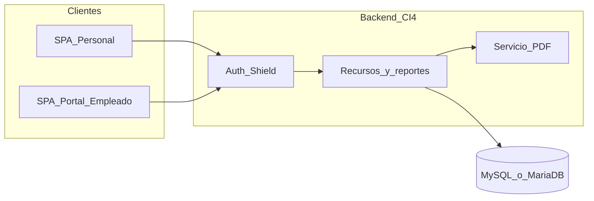
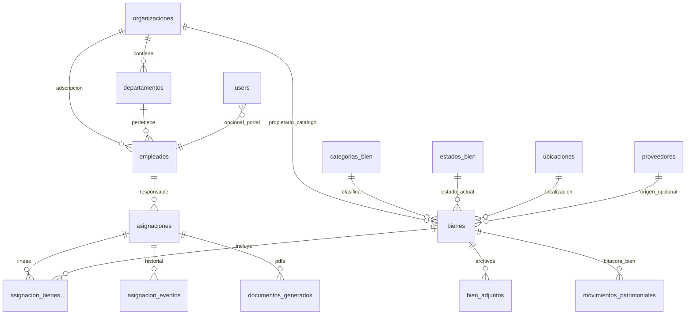

# Plan de desarrollo completo — Gestor de resguardos y préstamos patrimoniales

Documento maestro que concentra **objetivos de negocio**, **decisiones de producto**, **stack**, **arquitectura**, **funcionalidades priorizadas**, **modelo de datos robusto**, **riesgos**, **orden de implementación** y **entregables de documentación**. No sustituye los archivos detallados en `archivos proyecto resguardo/docs/` (cuando se generen), pero **no omite** lo acordado hasta la fecha.

---

## 1. Objetivo del producto

Aplicación **robusta** para:

- Gestionar **resguardos** (custodia formal de bienes asignados a una persona).
- Gestionar **préstamos** de equipo y otros bienes, con reglas operativas distintas (p. ej. plazo de devolución).
- Cubrir bienes de **cualquier tipo**, no solo cómputo: mobiliario, audio (bocinas), herramientas, etc.
- Mantener un **catálogo de organizaciones** a las que pertenecen los bienes. **No** es un sistema multi-tenant: no hay aislamiento lógico por “inquilino”; la organización es **referencia/catalogación**.
- Permitir a personal interno ver **qué resguardos y préstamos tiene cada empleado**.
- Generar **cartas responsivas** listas para impresión y firma, con **plantilla distinta** según sea **resguardo** o **préstamo**.
- Incluir **portal para empleados** (login) para consultar sus asignaciones y descargar/documentar cartas según política de acceso.
- Cubrir **seguridad** (authz authn, trazabilidad) y **funciones** de inventario, reportes y auditoría a nivel de aplicación.

---

## 2. Decisiones de producto confirmadas Cartas y acceso

| Tema | Decisión |
|------|-----------|
| **Cartas responsivas** | **Ambas**: vista HTML en la app con impresión desde navegador (`@media print`) **y** generación de **PDF en el servidor** para descarga y archivo/trazabilidad. |
| **Usuarios empleados** | **Portal con login** para empleados además del uso por personal interno (inventario, administración). |
| **Multitenencia** | **No**. Tabla(s) de organizaciones solo como catálogo de pertenencia de bienes y datos relacionados. |

---

## 3. Alcance funcional resumido (matriz rápida)

| Área | Incluye |
|------|---------|
| Dominio | Catálogos, bienes, asignaciones tipo resguardo/préstamo, histórico, folios |
| Personas | Empleados, usuarios internos, usuarios portal vinculados a empleado |
| Documentos | Plantillas diferenciadas, impresión, PDF, versionado de generación |
| Cumplimiento | Auditoría de cambios, movimientos patrimoniales, documentos con hash |
| Operación | Reportes, exportaciones, configuración de folios, despliegue |

---

## 4. Stack tecnológico (acordado con el prototipo)

Arquitectura **monorepo**: `backend/` (CodeIgniter 4.7.x, solo API REST) + `frontend/` (SPA React).

| Componente | Versión | Notas |
|------------|---------|--------|
| PHP / CodeIgniter | 4.7.x | API bajo `/api/v1/*` |
| CodeIgniter Shield | — | Access Tokens: header `Authorization: Bearer <token>` |
| React | 19.x | Hooks recientes, `ref` como prop |
| TypeScript | ~5.7 | Tipado estricto |
| Vite | 6.x | HMR, proxy a CI4 en desarrollo |
| Tailwind CSS | 4.x | Config vía `@theme` en CSS |
| React Router | 7.x | Rutas con `lazy()` por feature |
| Recharts | 2.x | Dashboard |
| Lucide | ~0.469 | Iconos |

Base de datos: **MySQL o MariaDB** (típico en hosting compartido). Conexión mediante variables `DATABASE_*` en `.env` del backend **únicamente** (ver sección 12).

---

## 5. Actores del sistema

1. **Administrador del sistema**: usuarios, grupos Shield, parámetros globales, plantillas si se editan desde UI (fase opcional).
2. **Personal de inventario / almacén**: altas y bajas de bienes, asignaciones, devoluciones, transferencias, impresión/PDF.
3. **Auditor / solo lectura**: reportes y consultas sin mutación (grupo dedicado).
4. **Empleado (portal)**: consulta de **sus** asignaciones activas e histórico permitido; descarga de carta/PDF según reglas; posibles avisos de vencimiento (fase posterior).

---

## 6. Convenciones de API

- Prefijo: **`/api/v1/`**.
- Formato de respuesta alineado al prototipo de reportes: JSON con forma **`{ data, meta?, error? }`**.
- CORS configurable por entorno (`CORS_ALLOWED_ORIGINS` en `.env`).
- Autenticación: filtro de tokens Shield en rutas protegidas.

### Endpoints ya contemplados en el prototipo `Api_V1_Reports.php`

Documentación interna del controlador entregado (referencia):

- `GET /api/v1/reports/dashboard` — KPIs y serie de movimientos.
- `GET /api/v1/reports/inventario` — listado paginado + filtros.
- `GET /api/v1/reports/inventario/export` — XLSX o PDF binario.
- `GET /api/v1/reports/bitacora` — bitácora paginada.
- `GET /api/v1/reports/bitacora/export` — XLSX o PDF binario.

Los nuevos recursos (CRUD bienes, asignaciones, empleados, PDF de carta, etc.) seguirán el mismo estilo de respuesta y seguridad.

---

## 7. Configuración backend relevante (Shield, CORS)

### Autenticadores Shield (referencia)

```php
public array $aliases = [
    'cors'   => \App\Filters\Cors::class,
    'tokens' => \CodeIgniter\Shield\Filters\TokenAuth::class,
];

// En Auth.php: defaultAuthenticator = tokens (Access Tokens para SPA)
```

### Variables de entorno (ejemplo, sin secretos reales)

```ini
CORS_ALLOWED_ORIGINS = http://localhost:5173,https://tu-dominio.example
# database.default.hostname = ...
# database.default.database = ...
# database.default.username = ...
# database.default.password = ...
```

Proyecto de ejemplo en README del prototipo: `https://inventario.planjuarez.org` — sustituir por el dominio final.

---

## 8. Estructura de carpetas del monorepo

### 8.1 Árbol base (como en `archivos proyecto resguardo/README_FRONTEND.md`)

El nombre raíz en el README de ejemplo es `inventario/`; en este repositorio la raíz real es `gestor-resguardos/`. La estructura lógica es la misma:

```
backend/                       # CI4 4.7.x — API REST
├── app/
│   ├── Controllers/Api/V1/
│   │   ├── Auth.php
│   │   ├── Reports.php
│   │   └── (futuro: Bienes, Asignaciones, Empleados, Documentos, …)
│   ├── Filters/
│   │   └── Cors.php
│   ├── Models/
│   ├── Services/              # PDF, folios, reglas de negocio
│   ├── Database/Migrations/
│   └── Config/
│       ├── Routes.php
│       └── Filters.php
└── public/
    └── build/                 # en producción: assets del SPA

frontend/                      # React 19 SPA
├── src/
│   ├── lib/apiClient.ts
│   ├── context/AuthContext.tsx
│   ├── components/
│   └── features/
│       ├── auth/Login.tsx
│       ├── dashboard/Dashboard.tsx
│       ├── inventario/Inventario.tsx
│       ├── bitacora/Bitacora.tsx    # pendiente / alinear con movimientos
│       └── (nuevo) asignaciones/, empleados/, organizaciones/, cartas/, portal-empleado/
```

### 8.2 Prototipos actuales en este repositorio

Ruta: [`archivos proyecto resguardo/`](archivos proyecto resguardo/).

| Archivo | Rol |
|---------|-----|
| `README_FRONTEND.md` | Plan frontend + monorepo |
| `frontend_setup.md` | Setup npm |
| `App.tsx`, `main.tsx` (si existe en copia futura), `index.html` | Shell SPA |
| `AuthContext.tsx`, `Login.tsx` | Auth cliente |
| `apiClient.ts` | Cliente HTTP + token |
| `Dashboard.tsx`, `Inventario.tsx` | Features de ejemplo |
| `Api_V1_Auth.php`, `Api_V1_Reports.php` | Referencia API |
| `Cors_filter_routes_api.php` | CORS + rutas ejemplo |

Estos archivos deben **integrarse** o **moverse** al monorepo definitivo `backend/` y `frontend/` cuando comience la implementación.

---

## 9. Arquitectura de alto nivel



---

## 10. Funcionalidades por orden de relevancia (fases sugeridas)

1. **Fundación**: autenticación con tokens, grupos/permisos Shield, usuarios internos, auditoría de acciones sensibles, CORS y variables de entorno, endpoint de salud (`health`) opcional.
2. **Catálogos**: organizaciones, categorías de bien, estados del bien (catálogo), departamentos, ubicaciones, empleados (datos mínimos para carta: nombre, identificador laboral, puesto, área).
3. **Inventario de bienes**: alta/edición/baja lógica, códigos/serie, pertenencia a organización, adjuntos (fotos/documentos) cuando aplique, búsqueda y filtros potentes.
4. **Asignaciones**: distinción **resguardo** vs **préstamo**; cabecera + líneas (varios bienes bajo un mismo folio/firma); plazos en préstamo; devolución; transferencias entre empleados con histórico explícito.
5. **Vista interna por empleado**: ficha con activos e histórico de asignaciones.
6. **Portal empleado**: login ligado a `empleado_id`; políticas estrictas de autorización (solo datos propios); listados y descargas permitidas.
7. **Cartas**: dos plantillas (resguardo / préstamo), responsive, impresión navegador; endpoint que genere **PDF** con la misma información legal; folio único por asignación; registro en `documentos_generados`.
8. **Reportes y exportaciones**: inventario, movimientos, asignaciones por organización/departamento; continuidad de XLSX/PDF como en reportes existentes.
9. **Seguridad avanzada**: rate limiting en login, políticas de contraseña Shield, rotación/revocación de tokens, consideración de 2FA como fase posterior.
10. **Operación**: logs estructurados, entornos dev/staging/prod, backups documentados, guía de despliegue (p. ej. nginx, o hosting compartido con `public/build`).

### Nota legal (obligatoria en documentación de usuario)

El **texto legal** de las cartas responsivas es **plantilla**: debe ser revisado y aprobado por el área jurídico-administrativa de la organización. La aplicación solo **parametriza** datos (quién, qué bienes, folio, fechas, condiciones operativas).

---

## 11. Modelo de datos — diseño robusto

### 11.1 Principios

- **Sin multitenencia**: `organizaciones` es catálogo; no se particionan datos por “tenant”.
- **Integridad**: FK con políticas claras; preferir **soft delete** en `bienes` y `empleados` si la normativa lo permite.
- **Concurrencia en folios**: generar folio en **transacción** con inserción de asignación o tabla de secuencias dedicada.
- **Trazabilidad**: tablas de eventos y auditoría para datos sensibles.
- **Alineación con prototipo**: unificar el concepto de `AssetMovementModel` / movimientos del inventario actual con **`movimientos_patrimoniales`** (un solo concepto en migraciones).

### 11.2 Diagrama entidad-relación (simplificado)



### 11.3 Tablas — inventario y catálogos

| Tabla | Propósito |
|-------|-----------|
| **`organizaciones`** | Catálogo de dueños/adscripción patrimonial del bien; no implica aislamiento multi-tenant. |
| **`departamentos`** | Áreas internas; opcional `organizacion_id`. |
| **`ubicaciones`** | Lugar físico (almacén, oficina); apoyo a inventario físico y traslados. |
| **`categorias_bien`** | Clasificación (mobiliario, audio, cómputo, etc.). |
| **`estados_bien`** | Catálogo (disponible, asignado, en_reparacion, baja, …); evita ENUMs frágiles. |
| **`proveedores`** | Origen de adquisición (opcional, útil en auditorías). |
| **`bienes`** | Activo: descripción, marca, modelo, serie, valores, `organizacion_id`, `categoria_id`, `estado_bien_id`, `ubicacion_id`, JSON `atributos_extra`, fechas alta/baja, `codigo_interno` único. |
| **`bien_adjuntos`** | Metadatos de archivos: `bien_id`, tipo, ruta o clave de almacenamiento, hash, tamaño, usuario que sube, timestamps. |

### 11.4 Tablas — personas y acceso

| Tabla | Propósito |
|-------|-----------|
| **`empleados`** | Datos para cartas y portal: nombre, identificador, puesto, `departamento_id`, `organizacion_id`, contacto, `activo`, soft delete opcional. |
| **Tablas Shield** | `users`, `auth_identities`, `auth_logins`, `auth_remember_tokens`, `auth_groups_users`, y demás tablas generadas por `shield:setup`. Son **obligatorias** para auth. |
| **Extensión `users`** | Columna **`empleado_id`** (nullable, **UNIQUE** donde aplica): vincula cuenta portal con `empleados`. Personal interno puede tener `NULL`. |

### 11.5 Tablas — resguardo / préstamo (núcleo)

| Tabla | Propósito |
|-------|-----------|
| **`asignaciones`** | Cabecera del acto: `tipo` (`resguardo` \| `prestamo`), `empleado_responsable_id`, **folio único**, `inicio`, `fin_prevista` (nullable p. ej. resguardo indefinido), `estado` (borrador, activa, devuelta, cancelada), snapshot de condiciones/cláusulas, `creado_por`, timestamps. **Una fila = un acto documental / firma**, aunque incluya varios bienes. |
| **`asignacion_bienes`** | Detalle N:N: `asignacion_id`, `bien_id`, `cantidad` (default 1), notas por línea. Habilita una carta con múltiples ítems. |
| **`asignacion_eventos`** | Historial: renovaciones de fecha, cambios de estado, transferencias, cancelaciones; `payload_json`. |
| **`documentos_generados`** | PDFs u otros: `asignacion_id`, tipo plantilla, versión, ruta o blob, `hash_sha256`, `generado_en`, `generado_por_user_id`. |

**Regla de negocio recomendada**: un mismo **bien** no debe aparecer en dos asignaciones **activas** simultáneas; enforce en servicio de dominio y, si el motor lo permite, constraints parciales o validaciones transaccionales.

### 11.6 Bitácora patrimonial y auditoría técnica

| Tabla | Propósito |
|-------|-----------|
| **`movimientos_patrimoniales`** | Eventos sobre el **bien**: alta, baja, cambio de ubicación/organización, ajuste; independiente de la asignación a persona. Evolución natural de `AssetMovementModel` en el código prototipo. |
| **`auditoria_cambios`** | Registro genérico: `tabla`, `registro_id`, `accion` (insert/update/delete), `usuario_id`, IP, user-agent, `valores_anteriores`, `valores_nuevos` (JSON), timestamp. Priorizar tablas sensibles: `bienes`, `asignaciones`, `empleados`, `users`. |

### 11.7 Configuración y folios

| Tabla | Propósito |
|-------|-----------|
| **`configuracion`** | Clave/valor: prefijo de folio, año fiscal de secuencia, parámetros cortos editables sin redeploy. |
| **`folios_consumidos` o secuencia atómica** | Estrategia documentada para unicidad bajo concurrencia (tabla de secuencias o `UPDATE` atómico en `configuracion`). |

### 11.8 Plantillas de carta

- **MVP recomendado**: plantillas HTML/motor en **código versionado** (Git); campo `version` en `documentos_generados`.
- **Tabla `plantillas_carta`** (opcional): solo si se necesita editar textos legales desde la UI sin desplegar código.

### 11.9 Tablas opcionales (fases posteriores)

| Tabla / módulo | Propósito |
|----------------|-----------|
| **`reservas`** | Reserva de bien a empleado/fecha sin asignación formal. |
| **`notificaciones` / cola de correo** | Avisos de vencimiento de préstamo. |
| **`mantenimientos`** | Órdenes por bien (si el producto crece a gestión de mantenimiento). |

### 11.10 Índices e integridad (checklist)

- **Únicos**: `bienes.codigo_interno` (o el campo que defina inventario), `asignaciones.folio`, `users.empleado_id` (donde no sea NULL).
- **Índices**: (`asignaciones.empleado_id`, `asignaciones.estado`); `asignacion_bienes.bien_id`; `bienes.organizacion_id`; `bienes.estado_bien_id`.
- **FK**: `ON DELETE RESTRICT` / `ON UPDATE CASCADE` según tabla; evitar borrados en cascada de bienes con asignaciones históricas sin antes cerrar legítimamente el registro.

---

## 12. Seguridad, datos y credenciales

### 12.1 Portal empleado (riesgo principal)

Sin filtrado estricto por `empleado_id` resuelto desde el **token** (o desde claims de sesión), existe ries grave de **IDOR**. Todo endpoint del portal debe:

- Resolver el empleado asociado al usuario autenticado.
- Denegar acceso a IDs de terceros aunque el cliente envíe otro `empleado_id` en la URL.

### 12.2 PDF en servidor

- Elegir librería (p. ej. Dompdf, TCPDF, mPDF) según hosting y calidad HTML→PDF.
- Definir si el PDF se **persiste** siempre en disco/almacenamiento o se regenera bajo demanda; el modelo `documentos_generados` asume trazabilidad de lo **oficial** entregado.

### 12.3 Credenciales de base de datos

- **Nunca** commitear host, usuario ni contraseña en Markdown, repositorio o capturas.
- Usar únicamente `.env` en servidor y/o secret manager del proveedor.
- Si en algún momento las credenciales se expusieron en chat, correo o ticket, **rotar contraseña** en el panel del hosting y actualizar `.env`.

*(Los valores concretos de host, nombre de base de datos, usuario y contraseña viven **solo** en `.env` del servidor o en el panel del proveedor; no deben figurar en el repositorio ni en este documento.)*

---

## 13. Orden de implementación sugerido (desarrollo de software)

1. Congelar **modelo de datos** (migraciones CI4) + **semillas**: organizaciones, categorías, estados de bien.
2. **CRUD** bienes + catálogos + permisos por grupo.
3. **Asignaciones** (cabecera + líneas) + reglas de estado + folios transaccionales.
4. Pantallas internas: extensión del inventario existente + **ficha empleado**.
5. **Portal empleado** + tests de autorización (negativos: otro `empleado_id`).
6. **Cartas** HTML + **PDF** + registro en `documentos_generados`.
7. Pulir **reportes**, exportaciones, auditoría y hardening (rate limit, logs).

---

## 14. Entregables de documentación (Markdown en el repo)

Además de **este archivo** en la raíz, el plan prevé generar en [`archivos proyecto resguardo/docs/`](archivos proyecto resguardo/docs/):

| Archivo | Contenido |
|---------|-----------|
| `01-proyecto-y-estructura.md` | Visión, actores, stack, árbol de carpetas, diagramas, convenciones API. |
| `02-funcionalidades-por-prioridad.md` | Lista ordenada + fases + nota legal. |
| `03-modelo-de-datos.md` | Tablas, relaciones, índices, estrategia de folios y plantillas. |
| `04-identidad-visual.md` | Plantilla casi vacía: tipografía, paleta, tono de marca. |

---

## 15. Checklist de tareas de documentación (estado)

- [ ] Crear carpeta `archivos proyecto resguardo/docs/`.
- [ ] Redactar `01-proyecto-y-estructura.md`.
- [ ] Redactar `02-funcionalidades-por-prioridad.md`.
- [ ] Redactar `03-modelo-de-datos.md`.
- [ ] Crear `04-identidad-visual.md` (plantilla vacía).
- [ ] **Hecho**: plan maestro en raíz — `PLAN_DESARROLLO_GESTOR_RESGUARDOS.md` (este documento).

---

## 16. Referencias cruzadas en el repositorio

- [`archivos proyecto resguardo/README_FRONTEND.md`](archivos proyecto resguardo/README_FRONTEND.md) — monorepo y stack frontend.
- [`archivos proyecto resguardo/Api_V1_Reports.php`](archivos proyecto resguardo/Api_V1_Reports.php) — contrato de reportes JSON.
- [`archivos proyecto resguardo/Inventario.tsx`](archivos proyecto resguardo/Inventario.tsx) — UI de inventario de ejemplo.

---

*Última consolidación: plan funcional y de datos revisado para robustez (asignación cabecera+líneas, auditoría, documentos PDF, portal empleado, sin multitenencia).*
